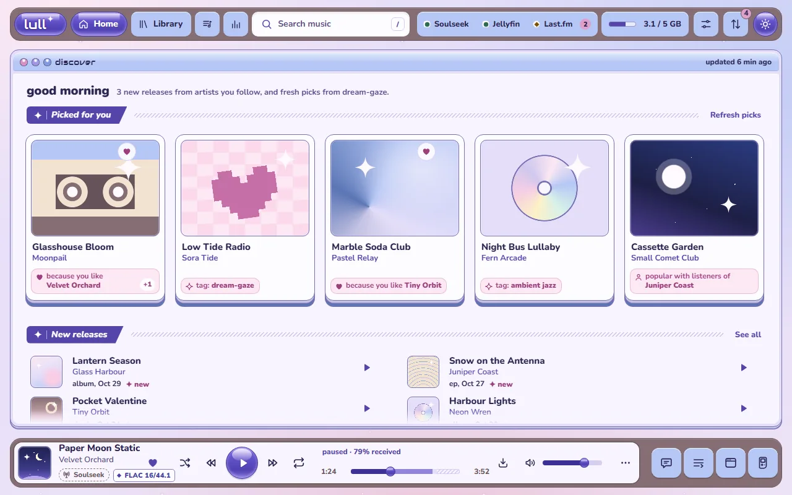

# lull

A self-hosted music player for one listener who runs Jellyfin.
- **Search Soulseek and play a song within seconds,** while it is still transferring.
- **Save what you want to keep:** lull finishes the file, tags it from MusicBrainz with cover art, writes it into your Jellyfin music folder, and plays it from Jellyfin from then on.
- **Everything else stays temporary.** Streamed songs live in a capped cache that empties itself.

## Features

**Find and play**
- **One search, two sources.** Your library answers at once. Soulseek results stream in, merged into one row per song across peers and grouped into albums.
- **Ranked sources.** Each source is scored on format against your preferred formats, peer speed, free upload slot and queue length; lull picks the best, or you choose. A transfer that stalls falls back to the next peer by itself.
- **Honest streaming.** The seek bar shows what has arrived, and you can seek only within it. Finding, queued, buffering, stalled, falling back and failed each look different.
- **A capped stream cache** (`LULL_CACHE_MAX_GB`). The oldest unused audio is evicted first, and nothing playing or being saved is ever evicted.

**Save**
- **On a song, an album or the whole queue.** lull completes the transfer, matches it on MusicBrainz, embeds Cover Art Archive art, tags it, names it consistently and asks Jellyfin to scan.
- **Safe defaults:** a duplicate check runs before saving, and when the match is genuinely unclear lull asks you to pick the release.

**Discover**
- **A home feed:** new releases from artists and tags you follow, picks from niche tags rather than charts, and radio from any song, artist or tag. It draws on ListenBrainz, MusicBrainz and Last.fm, and every pick says why it is there ("because you like X").
- **A small taste model on your server.** It learns from plays, completions, skips, likes and saves, weighted toward what you did recently, and you can reset it.
- **Last.fm:** now-playing updates and scrobbles by Last.fm's rules, with failed scrobbles kept and retried.

**The player**
- Queue, play next, shuffle, repeat one or all, gapless playback where the source allows, optional crossfade, and ReplayGain normalisation.
- Likes, history, playlists with M3U import (with a match preview) and export, and album, artist and tag pages.
- Lyrics from LRCLIB, synced where available.
- Keyboard shortcuts, media keys through the Media Session API, drag and drop, and a stats page.

**Five designs** (lull, skydeck, starlight, petal, glasshouse), each with a day and a night look or following your system. Switch in Settings › Appearance; the choice is kept per device.

**Classic mode:** a Winamp mini-player (Webamp) driven by the same queue. Skins come from the Winamp Skin Museum, with search, preview and favourites; lull caches the skin files.

**Everywhere:** it installs as an app from the browser (PWA), on desktop or phone. A thin desktop app for Windows and Linux adds a tray, a mini player and OS media keys.

### Additions beyond the brief

- A status tray and banners for Soulseek, Jellyfin, Last.fm and the cache. Soulseek turns to a warning when searches stop getting answers even though slskd says it is connected.
- One shared MusicBrainz request budget across the whole app, so saving and discovery never break its one-request-per-second rule.
- Cover art for songs found only on Soulseek, looked up once and cached.
- Duplicate notes on search rows for songs you already have, with a hint when the Soulseek copy is better.
- Jobs that survive a restart: transfers, saves, imports and rescans all show in the Activity panel.
- An optional access token for when lull is reachable beyond a private network.

## Install

You need Docker with Compose, a Jellyfin server with a music library, and a Soulseek account. Soulseek has no sign-up page: the first login with a new name creates the account.

1. Copy `deploy/compose.yaml` into a folder, and `deploy/.env.example` next to it as `.env`.
2. Fill in `.env`. At least set:
   - `MUSIC_DIR`: Jellyfin's music folder on the host;
   - `RUN_AS`: that folder's owner, as `uid:gid`;
   - `SLSK_USERNAME` and `SLSK_PASSWORD`;
   - `LULL_SLSKD_API_KEY`: a random string, for example from `openssl rand -hex 24`;
   - `LULL_JELLYFIN_URL` and `LULL_JELLYFIN_API_KEY` (Jellyfin › Dashboard › API Keys).

   Last.fm, ListenBrainz and the access token are optional. Every setting is explained in the file.
3. Pick how slskd reaches Soulseek with `COMPOSE_PROFILES`:
   - `plain`: through your own connection. It works without router changes, and forwarding `SLSK_LISTEN_PORT` lets more peers reach you.
   - `vpn`: through gluetun. Use a provider with port forwarding (Private Internet Access, ProtonVPN, Perfect Privacy or PrivateVPN) so peers can reach you.
   - empty: use an slskd you already run, via `LULL_SLSKD_URL` and an administrator API key.
4. `docker compose up -d`, then open `http://<host>:8080`.

The details of each setup are in [docs/context/deploy.md](docs/context/deploy.md).

**Desktop app:** tagged releases attach a Windows installer and Linux deb, rpm and AppImage packages. On first launch, enter your server's URL.

## For contributors

Start at [AGENTS.md](AGENTS.md). `mise run setup` once, then `mise run check` runs what CI runs.
